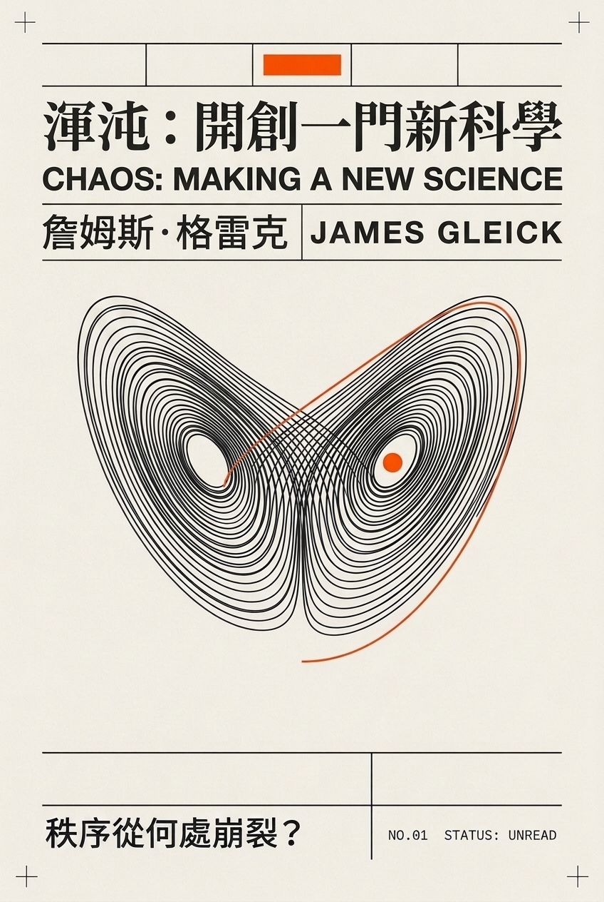
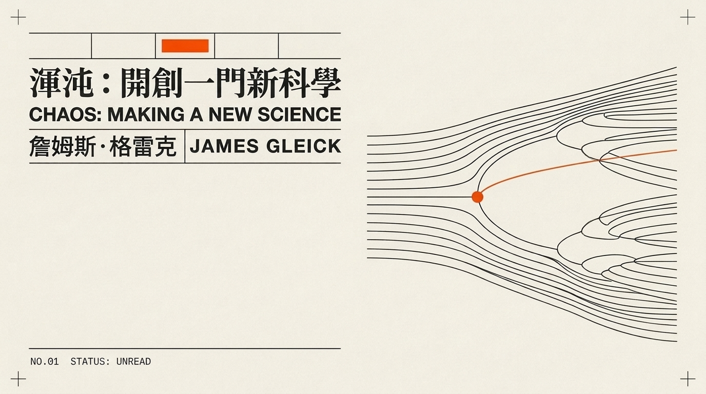
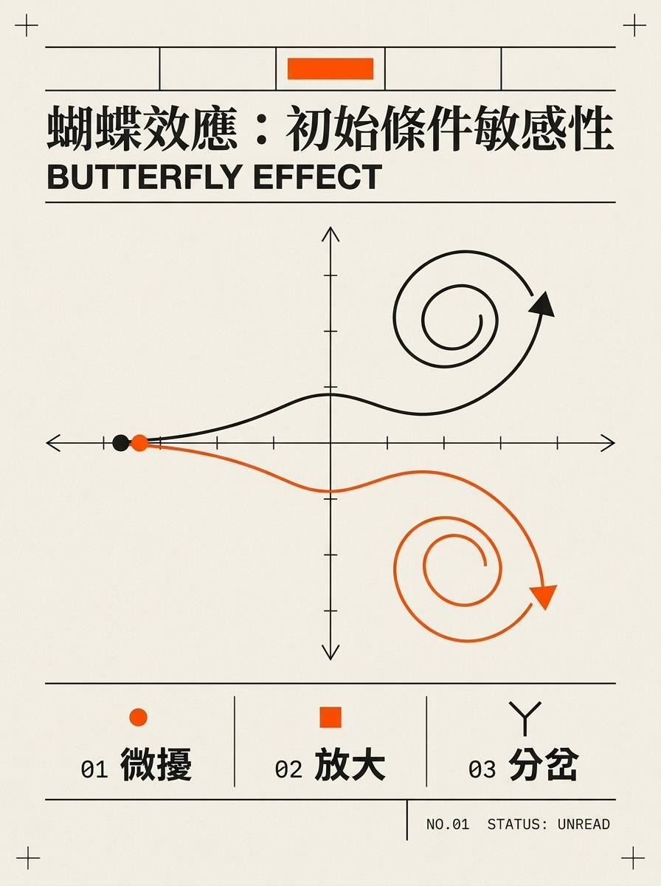
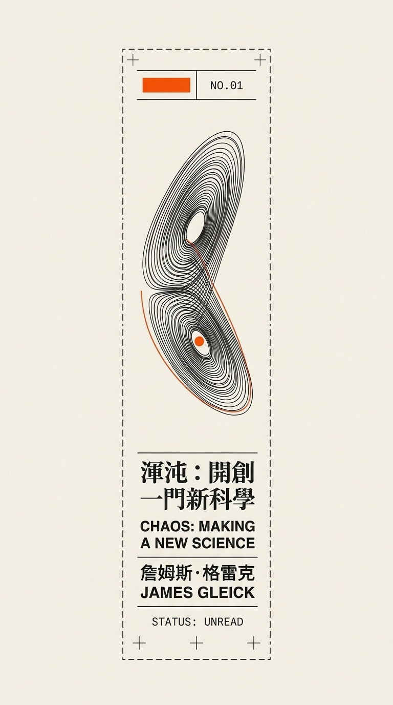

# NO.01｜《渾沌：開創一門新科學》（Chaos: Making a New Science）

- **作者**：James Gleick（詹姆斯·格雷克）
- **學科分類**：物理 Physics（重點色：國際信號橙 `#FF4F00`）
- **閱讀狀態**：`STATUS: UNREAD`
- **一句話命題**：微小的初始差異，如何在非線性系統中放大為截然不同的宏觀秩序與不可預測性。

---

## 三種版型視覺腳本（生成前定稿）

### 1. 單書封面海報 Book Cover Poster（`2:3` 直式，風格母圖）
- **視覺隱喻**：以 `0.5pt–1.5pt` 炭墨黑（`#171717`）等角細線繪製「勞倫茲奇異吸引子（Lorenz Attractor）」雙翼相空間軌跡，於軌道交會／分岔處放置一記國際信號橙（`#FF4F00`）實心圓點與微擾偏移線，象徵蝴蝶效應。
- **畫面文字（完整書目辨識 ＋ 10% 極簡配置）**：
  - 書名全稱：`渾沌：開創一門新科學` / `CHAOS: MAKING A NEW SCIENCE`
  - 完整作者：`詹姆斯·格雷克  JAMES GLEICK`
  - 核心提問：`秩序從何處崩裂？`
  - 狀態印章：`NO.01  STATUS: UNREAD`

### 2. 單書內頁橫幅 Banner / Cover（`16:9` 橫式，詳情頁頂部）
- **視覺重心**：左右不對稱構圖。左側 45% 乾淨象牙紙白（`#EFECE6`）放置書名、`MAKING A NEW SCIENCE`、`NO.01  STATUS: UNREAD`；右側 55% 展開橫向拉伸的相空間流線與倍週期分岔節點，以單一 `#FF4F00` 臨界點標示系統轉折。

### 3. 概念學習圖卡 Learning Card（`3:4` 直式，知識機制）
- **核心概念**：對初始條件的敏感依賴（蝴蝶效應）／倍週期分岔。
- **結構分配**：上方 65% 為雙軌起點幾乎重合卻在數步後劇烈分離的幾何座標圖解（黑線主軌＋橙線微擾軌）；下方 35% 僅保留 1 個標題與最多 3 個短關鍵詞（如 `微擾`、`放大`、`分岔`）及 `NO.01  STATUS: UNREAD`。

### 4. 藏書書籤 Bookmark（`9:16` 直長，中軸 `1:3` 裁切區）
- **視覺配置**：極窄直長印刷構圖，中央 `1:3` 安全區上下貫穿勞倫茲軌跡切線與單一 `#FF4F00` 圓點，直排或緊湊排列完整書名《渾沌：開創一門新科學》、作者 `詹姆斯·格雷克  JAMES GLEICK` 與 `NO.01  STATUS: UNREAD` 印章，兩側保留大面積象牙棉紙白方便實體裁切。

---

## 成品預覽（GitHub 手機版可直接檢視）

### 1. 單書封面海報（2:3）

### 2. 單書內頁橫幅（16:9）

### 3. 概念學習圖卡（3:4）

### 4. 藏書書籤（9:16 含 1:3 裁切區）

